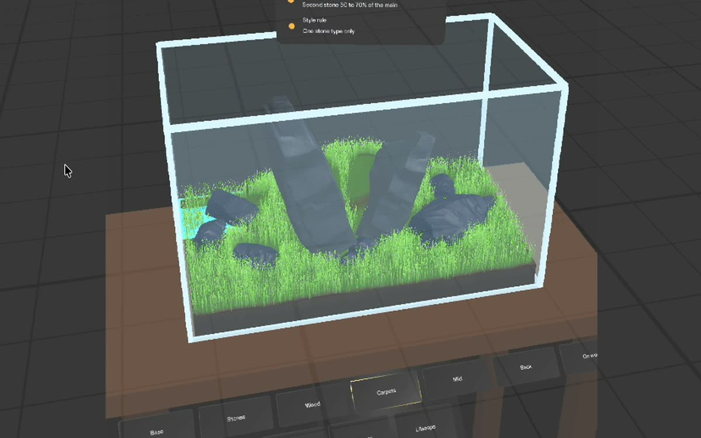
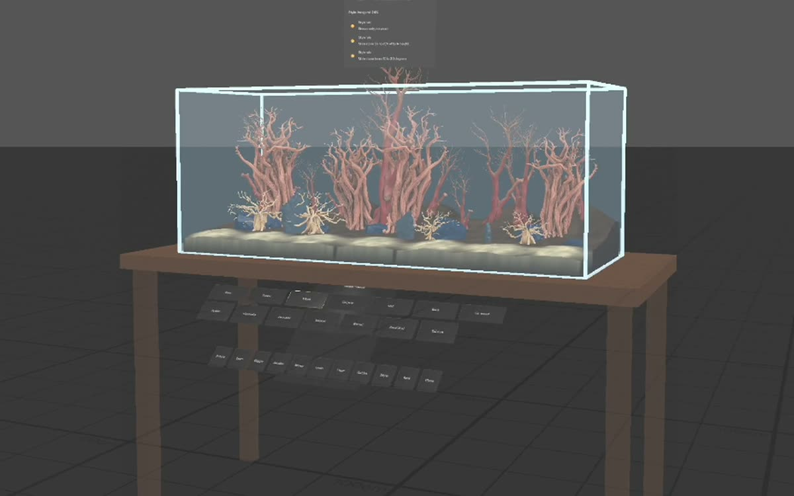
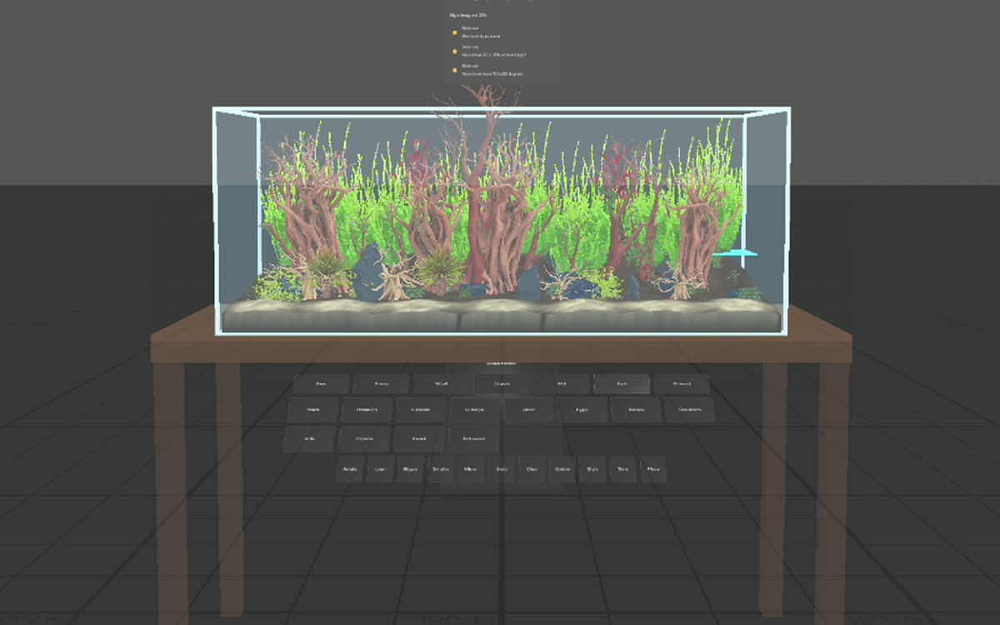
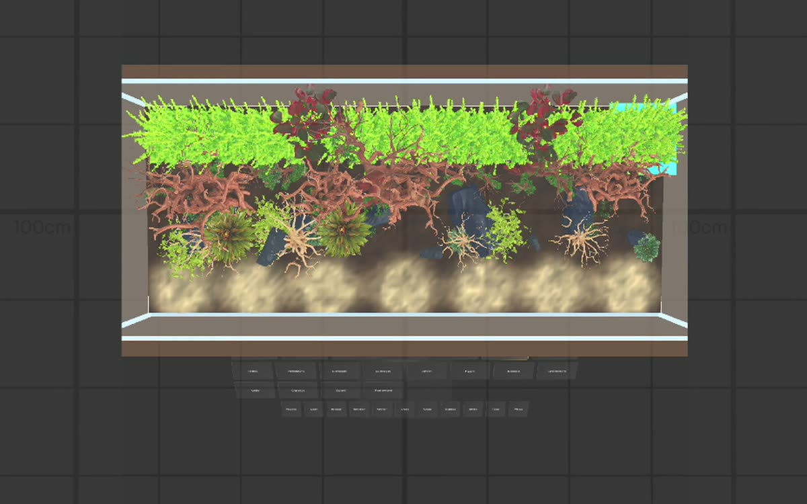

# Scape Planner

**Plan your aquascape at real size, inside the tank, before the water goes in.**
An augmented reality Lens for SPECS, built for the
[Learn AR with SPECS](https://learn-specs.devpost.com) hackathon.

Aquascapers compose a layout dry, because moving a stone after the tank is
filled clouds the water for days. Scape Planner puts the plan in the tank
you are standing in front of: soil and sand, stones and roots, carpets,
moss and stem plants, all at real size. A coach card checks the classic
composition rules and scores the layout against four styles. Your hands
stay free for the real stones.

| Hardscape | Planted | From above |
|---|---|---|
|  |  |  |

**Demo video:** linked from the Devpost submission (2:51, screen recording of the
Lens Studio preview).

## For judges: run it in two minutes

1. Clone the repository **with Git LFS** (the meshes and packages are LFS
   files): `git lfs install`, then `git clone`.
2. Open `AquascapeLens.esproj` in Lens Studio 5.22 or later.
3. In the Preview panel choose a **SPECS** device, **Interactive** input and
   the **Plane** scene (scene menu at the top of the panel).
   **Use Plane.** The furnished rooms (Sunlit Room and others) place the
   virtual table inside the room's furniture, so the tank ends up in a sofa.
4. The tank appears on a table about 1 m in front of you, with the palette
   tray along the front edge of the table. Look slightly down. Clicking acts
   as a pinch. Right-drag or hold Shift to look around, WASD to walk.
5. Optional: open the LEAF panel and run `scape-11-iwagumi-60p` (about
   3 minutes) or `scape-12-jungle-120p` (about 7 minutes) to watch a full
   layout being built with the palette.

## What it does

- **A tank at real size.** A virtual tank on a 75 cm table stands in for
  your real aquarium, which the preview cannot see. **Tank** cycles six
  standard sizes: 30C, 45P, 60P (the default, 60 x 30 x 36 cm), 75P, 90P
  and 120P. **Place** re-anchors the tank in front of you.
- **Build the substrate.** The **Base** tab has soil and sand mounds. They
  pile on the sloped base layer, merge into ridges, and can be dragged,
  resized or removed. The cut face of the substrate shows through the front
  glass, and every piece re-seats on the new surface.
- **Hardscape.** Seven stones (Seiryu, Dragon, lava, Frodo, Elephant skin,
  Pagoda, a flat dark slate) and seven woods (spider wood, Manzanita,
  Redmoor, Mopani, bonsai, a tall Redmoor root and a multi-trunk root
  cluster). Stones and wood sink into the soil like real ones.
  **Rotate**, **Lean** (up to 40 degrees, in any direction with Rotate),
  **Bigger**, **Smaller** and **Mirror** act on the selected piece, so a
  few models give many different stones.
- **Carpets are laid tile by tile.** Each tap on a carpet plant lays a tile
  next to the last one, row by row from the front glass. Tiles overlap so
  they knit into one lawn, follow the substrate's hills, and leave a bare
  ring where a stone meets the soil. Hairgrass and Lilaeopsis are grass
  blades; Monte Carlo, HC Cuba and Glossostigma are small round leaves.
- **Plants.** 24 species for the midground and background (Cryptocoryne,
  Staurogyne, Blyxa, Downoi, red lotus, Rotala, Ludwigia, Hygrophila,
  Vallisneria, Amazon sword and more). Each carries its real footprint,
  height and mature height.
- **Epiphytes grow on the wood.** Moss, Anubias, Bucephalandra and Java fern
  attach to the selected stone or root at a real point on its surface:
  Anubias and Buce low near the foot, moss at mid-height, on the side facing
  you. Moss is laid as small leaves over the wood, not as a lump. Epiphytes
  follow their host when it moves, and re-attach wherever they are dropped.
- **The coach.** After every change the coach card checks focal point on a
  third, odd number of hardscape pieces, a gap to the front glass,
  hardscape height and plant zones. **Style** cycles Iwagumi, Nature,
  Dutch and Jungle and scores the layout 0 to 100 against that style's
  rules, listing the rules to fix first.
- **Undo**, **Clear** and **Guides** round it off.

Everything runs in Lens Studio's Interactive Preview. No SPECS glasses are
needed.

## How it was planned and built

- Planned with the Devpost Learn **plan-lens** skill pack. The approved
  design brief, the interview answers and the research behind them are in
  `devpost/`.
- Built in Lens Studio 5.24 through the **Lens Studio MCP**, following
  **CLAD**'s skills (scene construction, UI Kit, interaction recipes, LEAF,
  MeshBuilder). The build log in `devpost/build-log.md` records every
  version and what was tested.
- The substrate, carpet tiles and moss are generated at runtime with
  MeshBuilder and a vertex-colour material.

## Tests

`Assets/Tests/` holds LEAF scenarios that run in the preview; `LeafIndex.ts`
registers them.

- `scape-1` to `scape-8`: the done criteria from the design brief (tank and
  guides, place and drag, focal point, odd count, undo and clear), palette
  reach, style scoring with rotate and lean, palette tabs and tank sizes.
- `scape-10`: soil and sand mounds raise the substrate, carpet tiles lay a
  row, moss follows its stone, Mirror and Bigger.
- `scape-11-iwagumi-60p` and `scape-12-jungle-120p`: two complete layouts
  built through the palette. They assert nothing and serve as showcases.
- `scape-9-demo`: an older walkthrough kept for reference.

All of them pass in the preview.

## About the demo video

The video is a screen recording of the Lens Studio preview. The two layouts
are built by the `scape-11` and `scape-12` LEAF scenarios, which press the
same palette buttons a user would. LEAF cannot drag a piece to an exact
spot, so these two scenarios place each finished piece with
`ScapePlannerMain.moveSelectedTo`, which ends the move exactly like a drag
release. Dragging by hand works in the preview and is covered by
`scape-2` and `scape-3`. The camera was moved over the MCP while recording,
and the build sequences are sped up in the edit.

## Project layout

- `AquascapeLens.esproj`: Lens Studio 5.24 project (SPECS target).
- `Assets/Scripts/`: the Lens code.
  - `ScapePlannerMain.ts`: layout state, palette actions, coach, placement.
  - `ScapePlannerTank.ts`: tank, table, glass, guides and sizes.
  - `ScapePlannerSubstrate.ts`: the substrate height field and its mesh.
  - `ScapePlannerCarpet.ts`: procedural carpet tiles.
  - `ScapePlannerPiece.ts`: one placed piece: fitting, grab, seating,
    mirror, epiphyte attachment and moss.
  - `ScapePlannerCatalog.ts`: the 48 placeable pieces with sizes, zones,
    tabs and tints.
  - `ScapePlannerRules.ts`, `ScapePlannerStyles.ts`: composition checks and
    style scoring as pure functions.
  - `ScapePlannerPaletteUI.ts`, `ScapePlannerCoachUI.ts`: UI Kit panels.
- `Assets/GeneratedMeshes/`: the 3D models (see below).
- `Assets/Tests/`: LEAF scenarios.
- `devpost/`: planning documents, build log, preview images, video script.

## Third-party and pre-existing material

- **Snap's Specs Base Template** was the starting project. It brings
  **Spectacles Interaction Kit** and **Spectacles UI Kit** (`Packages/`).
- **LEAF** (Lens testing framework, `Leaf.lspkg`) from Snap.
- **SimpleVertexBaseColor** material package, from CLAD's mesh-builder
  skill, for the vertex-coloured meshes.
- **3D models** in `Assets/GeneratedMeshes/` were generated for this
  project with **Meshy** under the author's paid plan. Pots and bases were
  trimmed off some plant models in Blender. Species that share a growth
  form reuse a model with a colour tint; the catalogue marks them as
  variants.
- All Lens code in `Assets/Scripts/` and `Assets/Tests/` was written during
  the submission period, with an AI coding agent.

## Credits

Composition rules after public aquascaping guidance (sources listed in
`devpost/research-notes.md`).
